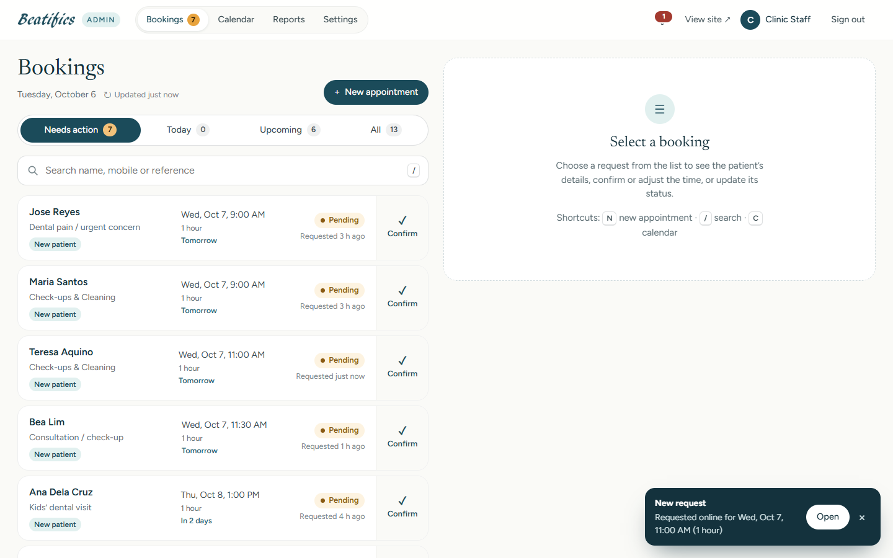
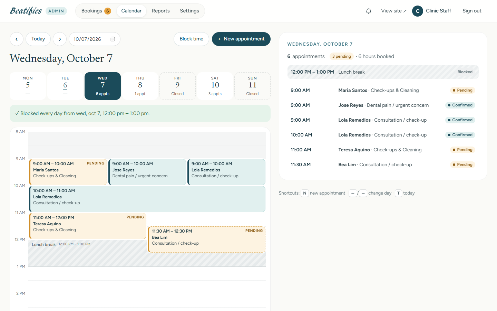
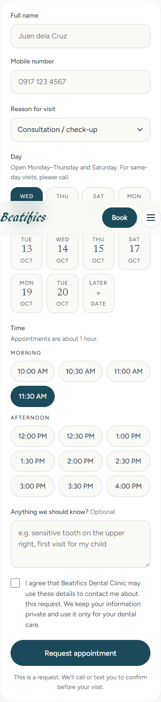
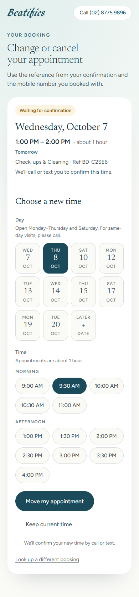
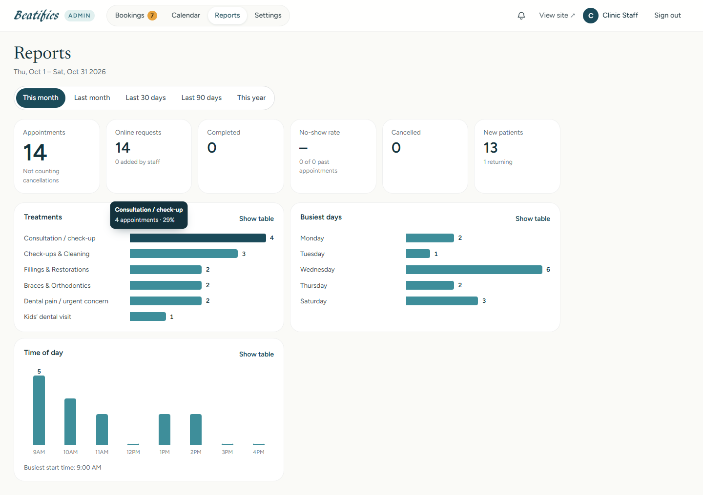

# Beatifics Dental Clinic

Website and booking system for **Beatifics Dental Clinic**, 0200 E National Highway, Tunasan, Muntinlupa City.

- **Patients** pick a treatment, day and free time on the clinic website, and can change or cancel their booking online.
- **Staff** manage requests in an admin portal: confirm them, add phone and walk-in appointments, see the day on a calendar, block holidays and breaks, and check reports.

| Admin: bookings & alerts | Admin: calendar |
|---|---|
|  |  |

| Booking on a phone | Changing a booking | Reports |
|---|---|---|
|  |  |  |

---

## Contents

- [Features](#features)
- [Quick start](#quick-start)
- [Scripts](#scripts)
- [Configuration](#configuration)
- [Deploying](#deploying)
- [Backups](#backups)
- [Project structure](#project-structure)
- [How booking works](#how-booking-works)
- [Privacy & security](#privacy--security)
- [Contributing](#contributing)

## Features

### Public website (`/`)
- One-page clinic site: services, the dentist, what to expect, opening hours and directions.
- **Online booking**: choose a treatment, then a day, then a free time. Only times with room are shown. Fully booked days are marked, and Wednesdays, Sundays and blocked dates can't be picked.
- Confirmation screen with a **booking reference** (e.g. `BD-7K3Q9`).
- **Manage my booking** (`/manage`): with the reference and mobile number, patients can **reschedule** or **cancel** until the day before their appointment.

### Admin portal (`/admin`)
- **Bookings**: *Needs action / Today / Upcoming / All*, search by name, mobile or reference, a **one-click Confirm** on each pending request, and *New patient / Returning / no-show* tags.
- **Booking details**: confirm or adjust the time and length (you see that day's other appointments and get a warning if the clinic would be overbooked), mark completed or no-show, cancel or reopen, add staff notes, copy a ready-made confirmation text, and view **patient history** and an **activity log**.
- **New appointment** for phone bookings and walk-ins: type the mobile number and a returning patient's name fills in. The form suggests the earliest free time.
- **Dentists**: each dentist has working days and a colour, and sees one patient at a time. Patients can pick a dentist online or choose "Any dentist"; returning patients stay with their usual dentist. Dentists who sign in see **their own patients** first.
- **Calendar**: week strip and day timeline with **one column per dentist**. Click any empty time in a column to book that dentist. Blocked times and days off are shaded.
- **Blocked times**: holidays, a dentist's leave or a daily lunch break, for the whole clinic or one dentist, once, daily or weekly. Shows which existing bookings fall inside.
- **Alerts**: pop-up, soft chime and optional desktop notification when a patient books, cancels or reschedules. The pending count shows in the browser tab.
- **Reports**: appointments, no-show rate, cancellations, new vs returning patients, treatments, busiest days and times.
- **Settings**: time per patient, length per treatment, how many patients can be seen at once (chairs), dentists and their working days, staff accounts with *Admin* and *Staff* roles, the full activity log, and changing your own password.
- **Keyboard shortcuts**: `N` new appointment · `/` search · `C` calendar · `B` bookings · `←` `→` `T` in the calendar · `Ctrl+Enter` saves notes.
- Works on phones and tablets; on phones the admin menu is a bottom tab bar.

## Quick start

**Requirements:** [Node.js](https://nodejs.org/) **22.13 or newer** (it uses Node's built-in SQLite, so there's no database to install).

```bash
npm install
npm run seed:demo   # optional: demo accounts and sample bookings
npm run dev
```

Open:

- Website: <http://localhost:5173>
- Admin portal: <http://localhost:5173/admin>

Demo logins (created by `seed:demo`, password **`beatifics-demo`**):

| Email | Role |
|---|---|
| `admin@beatifics.local` | Admin: everything, including settings and staff accounts |
| `reception@beatifics.local` | Staff: bookings, calendar, blocked times, reports |
| `dentist@beatifics.local` | Staff, linked to the demo dentist "Dr. Rebecca Vivo", so it opens on their own patients |

To start again with an empty database, stop the app and delete the `data/` folder.

## Scripts

| Command | What it does |
|---|---|
| `npm run dev` | API on port 3001 and the website on port 5173, with live reload |
| `npm test` | Runs all tests (shared logic and the API) |
| `npm run typecheck` | TypeScript check |
| `npm run build` | Type-checks and builds the website into `dist/` |
| `npm start` | Runs the API and serves the built website on port 3001 |
| `npm run create-admin -- <email> "<name>" <password>` | Creates an admin account, or resets its password and reactivates it if the email exists |
| `npm run seed:demo` | Adds demo accounts and sample bookings (refuses to run in production) |

## Configuration

Copy `.env.example` to `.env` and adjust:

| Variable | Default | Meaning |
|---|---|---|
| `PORT` | `3001` | Port for the API (and the website in production) |
| `DATABASE_PATH` | `./data/beatifics.db` | SQLite database file; created automatically |
| `NODE_ENV` | `development` | Set to `production` when deploying: enables secure cookies |

Clinic details (name, phone, address, social links) and the list of treatments are in [`shared/constants.ts`](shared/constants.ts). Opening hours are in [`shared/dates.ts`](shared/dates.ts). The website text is in [`client/src/site/`](client/src/site/).

## Deploying

The app is one Node.js process plus one SQLite file, so it needs a host that keeps files between restarts: a small VPS, or a platform with a persistent disk (Railway, Render, Fly.io and similar). Serverless hosts that wipe files on each deploy, such as Vercel, **won't keep the database**.

```bash
npm ci
npm run build
NODE_ENV=production DATABASE_PATH=/var/lib/beatifics/beatifics.db npm start
npm run create-admin -- owner@clinic.ph "Dr. Rebecca Vivo" "a-long-secure-password"
```

Checklist:

1. Serve it over **HTTPS**. In production the login cookie is marked `Secure` and won't work over plain HTTP.
2. Put the database on the persistent disk (`DATABASE_PATH`).
3. Create the first admin with `create-admin`. Add everyone else in **Settings → Staff**.
4. Don't run `seed:demo` in production.
5. A reverse proxy (Nginx, Caddy) on the **same machine** works as-is. If the proxy runs elsewhere, update `app.set('trust proxy', …)` in [`server/app.ts`](server/app.ts) so rate limits see real client addresses.
6. Set up [backups](#backups).

## Backups

All data (bookings, accounts, settings, the activity log) lives in the SQLite file at `DATABASE_PATH`. The database uses write-ahead logging, so copy it safely:

- **Simplest:** stop the app, copy `beatifics.db` (plus any `beatifics.db-wal` and `beatifics.db-shm` files), then start it again.
- **While it's running:** `sqlite3 /var/lib/beatifics/beatifics.db ".backup '/backups/beatifics-$(date +%F).db'"`

Back up at least daily and keep copies off the server.

## Project structure

```
client/            React website + admin portal (Vite)
  src/site/        Public site, booking form, time-slot picker, "manage my booking"
  src/admin/       Admin portal (loaded only when /admin is opened)
  src/styles/      CSS; design tokens live in base.css
server/            Express API
  routes/          public.ts, auth.ts, admin.ts
  bookings.ts      Queries, availability, reports
  db.ts            SQLite connection and migrations
shared/            Code used by both client and server: validation, dates (Manila time), scheduling rules
scripts/           create-admin, seed-demo
docs/              Approved design draft and screenshots
.claude/agents/    AI helper agents used during development (see CLAUDE.md)
```

The database schema is upgraded automatically on start. Migrations are an append-only list in [`server/db.ts`](server/db.ts).

## How booking works

- **Clinic hours:** Monday, Tuesday and Thursday–Saturday, 9:00 AM – 5:00 PM. Closed Wednesday and Sunday. All times are **Asia/Manila**.
- **Online requests** can be made from tomorrow up to 60 days ahead. Start times are every 30 minutes, and the appointment must finish by closing time. Same-day visits are by phone.
- **Length:** each treatment uses its own length if one is set in Settings, otherwise the default time per patient (1 hour).
- **Capacity:** a time is offered only if fewer than *"patients at the same time"* (chairs, default 2) bookings overlap it and it doesn't touch a blocked time.
- **Dentists:** once dentists are added, a time also needs a dentist who works that day, isn't on leave and isn't already seeing someone. "Any dentist" requests are assigned automatically, preferring the patient's regular dentist. Until dentists are added, the clinic works on chairs alone.
- **Statuses:** `pending → confirmed | cancelled`, `confirmed → completed | no-show | cancelled`, and a cancelled booking can be reopened. Online requests start as pending until staff confirm them.
- **Staff may overbook on purpose**, for example to fit in an emergency. The portal warns them first.

## Privacy & security

Patient details are personal information under the **Philippine Data Privacy Act of 2012 (RA 10173)**.

- The booking form collects only name, mobile, treatment, time and an optional note, and asks for consent.
- Patients can look up only their own booking, and only with the reference plus the matching mobile number.
- Staff passwords are hashed (scrypt). Login sessions use secure, HTTP-only cookies and expire after 7 days. Deactivating an account signs that person out immediately.
- Rate limits protect booking, login and booking lookup. A hidden field catches spam bots.
- Every change to bookings, settings, blocked times and accounts is recorded in the activity log with who made it.

## Contributing

- Read [`CLAUDE.md`](CLAUDE.md) first. It has the full domain rules, API reference and conventions.
- Run `npm run typecheck` and `npm test` before committing. Add tests next to the code (`*.test.ts`).
- Design for **few clicks and short mouse travel**, and check every screen on a phone (~390px wide).
